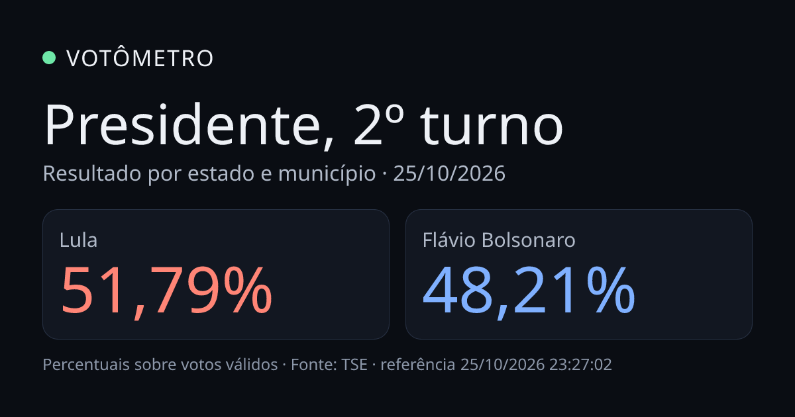
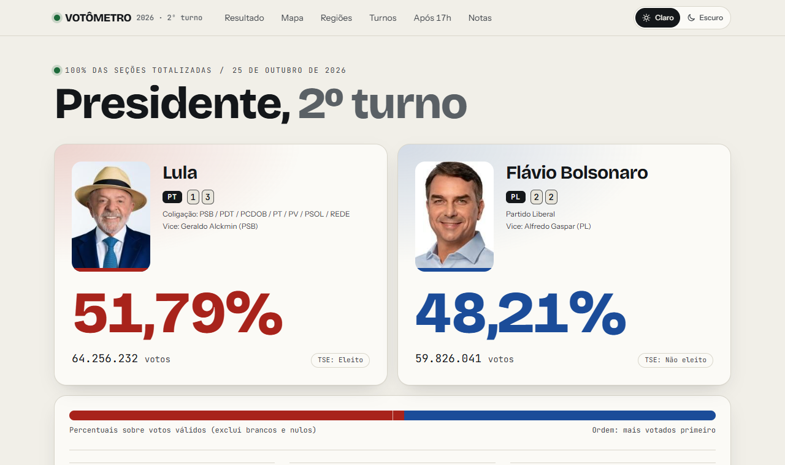
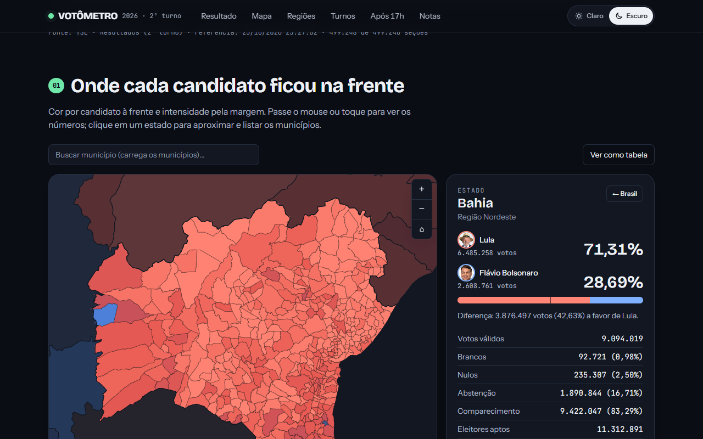
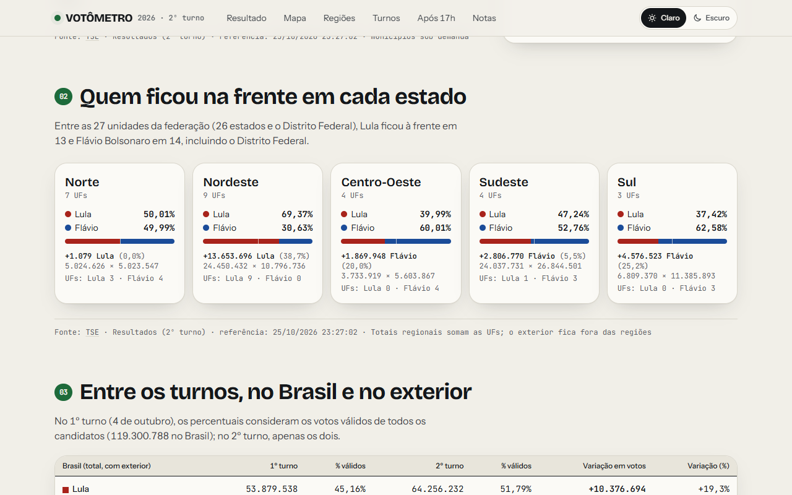
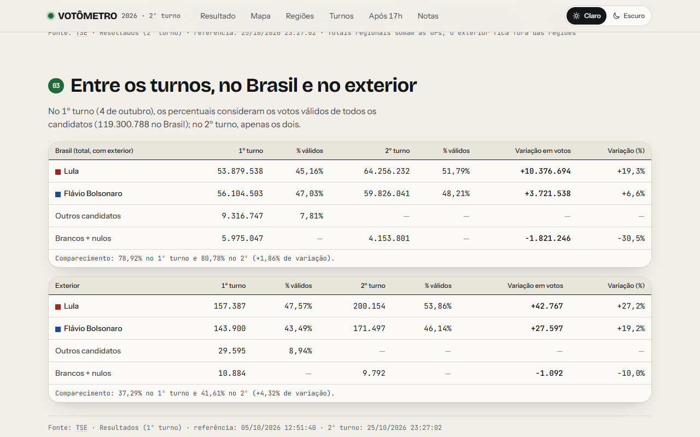
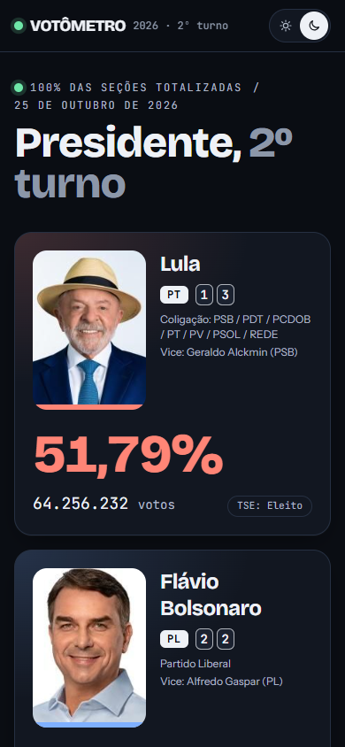

<div align="center">



# Votômetro

**O resultado do 2º turno de 2026, direto da fonte.**<br />
Mapa por estado e município, comparação com o 1º turno, voto no exterior e fonte e horário em cada número.

<br />

[](https://votometrobr.vercel.app)


<br />

<picture>
  <source media="(prefers-color-scheme: dark)" srcset="docs/screenshots/principal-dark.png" />
  
</picture>

<sub>Capturas com os dados reais do TSE (referência 25/10/2026 23:27:02).</sub>

</div>

<br />

## ✨ O que dá para fazer

| Recurso | Descrição |
| --- | --- |
| **Mapa interativo** | Veja quem ficou à frente em cada estado, com tooltip e legenda. Dê zoom e arraste, ou use as setas do teclado. |
| **Estado e municípios** | Clique num estado para aproximar e listar os municípios dele, com filtro e ordenação. |
| **Busca de município** | Digite o nome e escolha na lista com autocomplete, inclusive pelo teclado. |
| **Resumo por região** | Compare Norte, Nordeste, Centro-Oeste, Sudeste e Sul: percentuais, diferença em votos e quantos estados cada lado venceu. |
| **Entre os turnos** | Veja a variação de cada candidato do 1º para o 2º turno, no Brasil e no exterior, sempre com sinal (+ ou −). |
| **Todos os estados** | Tabela que você pode ordenar e filtrar por região, como alternativa acessível ao mapa. |
| **Seções após as 17h** | Mede o resultado das seções que encerraram depois do horário regular. Nunca estima nada (veja abaixo). |
| **Claro e escuro** | Segue o tema do seu sistema e deixa trocar com um clique. |

## 🖼️ Telas

<table>
  <tr>
    <td width="50%"><br /><sub><b>Estado</b>: municípios coloridos pelo candidato à frente e painel com os totais.</sub></td>
    <td width="50%"><br /><sub><b>Regiões</b>: percentuais, diferença em votos e estados vencidos.</sub></td>
  </tr>
  <tr>
    <td width="50%"><br /><sub><b>Turnos</b>: 1º e 2º turno lado a lado, com a variação de cada linha.</sub></td>
    <td width="50%"><br /><sub><b>Celular</b>: o layout empilha os candidatos e o mapa ocupa a largura da tela.</sub></td>
  </tr>
</table>

## 🧠 Como funciona

| Conceito | Regra |
| --- | --- |
| **Dados** | Tudo que aparece na tela sai de `public/data/*.json`, gerado por `npm run build-data`. Nenhum número é digitado à mão. |
| **Percentuais** | Calculados sobre os votos válidos (sem brancos e nulos), com os dois candidatos no mesmo formato. |
| **Cor do mapa** | Vermelho para Lula à frente, azul para Flávio Bolsonaro à frente. Cinza em 50%. A intensidade cresce até 30 pontos de diferença. |
| **Validação** | O build falha se estados + exterior ≠ total nacional, se os totais fugirem dos valores de referência ou se as contas de comparecimento e abstenção não fecharem. |
| **Fonte e horário** | Cada seção mostra “Fonte: TSE”, o arquivo de origem e a data/hora de referência do arquivo. |
| **Seções após as 17h** | O Boletim de Urna traz a hora de abertura e de encerramento de cada seção, mas não a hora de cada voto. Por isso o painel mede as **seções** que encerraram mais de 15 minutos depois das 17h (Brasília), nunca “votos depois das 17h”. |

> [!NOTE]
> Os Boletins de Urna do 2º turno ainda não estavam publicados quando os dados foram gerados. Enquanto isso,
> o painel mostra “indisponível” e explica o motivo, sem números. Rode `npm run build-data` de novo quando o
> TSE publicar. O cálculo foi testado com os boletins do 1º turno (Acre).

## 📚 Sobre os dados

| Dado | Fonte |
| --- | --- |
| Resultados por Brasil, UF, exterior e município (1º e 2º turno) | API de resultados do TSE, `resultados.tse.jus.br/oficial/ele2026` (`6258` = 2º turno, `6257` = 1º turno) |
| Fotos dos candidatos | Arquivos de fotos do TSE, copiados para `public/img/candidatos/` |
| Geometrias | API de malhas do IBGE, simplificadas em `scripts/build-geo.ts` |
| Horário de encerramento das seções | Boletim de Urna, dados abertos do TSE |

Limitações conhecidas:

- A abstenção no arquivo do TSE é 19,22%. A imprensa cita entre 19% e 19,2%. A diferença está em “Notas”, na própria página.
- O município de Boa Esperança do Norte (MT) tem resultado, mas não tem polígono na malha do IBGE. Ele entra nos totais e na busca, não no desenho.
- O exterior é um território à parte e não aparece no mapa.
- A API do TSE não é documentada formalmente, então o caminho dos arquivos pode mudar.
- O corte de 15 minutos é um critério de medição, não uma definição legal de prorrogação.

## 🚀 Rodando localmente

Requer [Node.js](https://nodejs.org) e npm.

```bash
npm install
npm run build-data   # baixa TSE + IBGE, gera public/data e valida os totais (leva alguns minutos)
npm run dev          # http://localhost:3000
```

Os arquivos de `public/data` já estão no projeto, então você pode pular o `build-data` se só quiser ver o site.

| Comando | O que faz |
| --- | --- |
| `npm run dev` | Servidor de desenvolvimento em `localhost:3000` |
| `npm run build` | Valida os totais e gera o site estático em `out/` (falha se os números não baterem) |
| `npm run build-data` | Baixa os dados do TSE e do IBGE e regenera `public/data` |
| `npm run validate` | Roda só a validação sobre os JSON já gerados |
| `npm run overtime` | Procura os Boletins de Urna do 2º turno e regenera o painel das 17h |
| `npm run typecheck` | Checa os tipos com o TypeScript |

> [!NOTE]
> Não rode `npm run build` com o servidor de desenvolvimento ligado. Os dois usam a pasta `.next` e o
> servidor quebra. Se acontecer, pare o servidor, apague `.next` e inicie de novo.

O TSE responde `429` quando recebe pedidos demais. O script espaça as requisições, pausa sozinho e guarda
cada resposta em `.cache/tse`. Apague essa pasta (`rm -rf .cache`) para forçar um novo download.

## 🔑 Variáveis de ambiente

| Variável | Para que serve | Se não definir |
| --- | --- | --- |
| `NEXT_PUBLIC_SITE_URL` | URL pública do site. Alimenta o canonical, o Open Graph, o `robots.txt` e o `sitemap.xml`. | Usa `https://votometrobr.vercel.app`. |

Só precisa definir se publicar em outro domínio:

```bash
NEXT_PUBLIC_SITE_URL=https://seu-dominio.com.br npm run build
```

## 🗂️ Estrutura

```text
scripts/            build-data · build-geo · build-overtime · validate · lib/tse
public/
├── data/           JSON gerados (nacional, estados, municípios, 17h) e geo/ com os TopoJSON
└── img/            fotos dos candidatos
src/
├── app/            página, layout, favicon, imagem Open Graph, robots e sitemap
├── components/     Hero, seções, tabela de estados, tema, seletor de candidato
│   └── map/        BrazilMap (SVG + Canvas), legenda, tooltip, painel e busca
└── lib/            tipos, formatação, estatísticas, cores, geometria, validação, site
docs/               banner e capturas de tela deste README
```

<details>
<summary><b>Como o mapa carrega os municípios</b></summary>

1. O mapa do Brasil desenha só os 27 estados (SVG), leve e imediato.
2. Ao clicar num estado, o arquivo `municipios-XX.json` e a malha `municipios-XX.topo.json` dele são baixados sob demanda.
3. Os municípios são desenhados em Canvas, com índice em grade e `isPointInPath` para saber qual está sob o mouse.
4. Durante zoom e arraste, o Canvas reaproveita uma imagem pronta do desenho e só redesenha ao parar.
5. A lista de busca usa um arquivo único leve (`municipios.json`), carregado quando você foca o campo.

</details>

## 🌐 Deploy

O site é exportado como HTML estático (`output: "export"` em `next.config.mjs`), então funciona em Vercel,
Netlify, GitHub Pages ou qualquer hospedagem de arquivos. Publique a pasta `out/`.

- O site está no ar em [votometrobr.vercel.app](https://votometrobr.vercel.app). Esse é o endereço padrão do Open Graph, do canonical e do sitemap; em outro domínio, defina `NEXT_PUBLIC_SITE_URL` no build.
- A imagem de compartilhamento (`opengraph-image`), o `twitter-image` e o `apple-icon` saem sem extensão. O `vercel.json` força
  `Content-Type: image/png` neles; em outra hospedagem, faça o equivalente.
- Se os dados mudarem, rode o build de novo: a imagem de compartilhamento usa os números do momento.

## 🧭 Próximos passos

- [ ] Publicar o painel “Após as 17h” com números assim que o TSE liberar os Boletins de Urna do 2º turno.
- [ ] Adicionar testes automatizados (hoje a garantia é a validação dos totais no build).
- [ ] Medir o desempenho do mapa em celulares reais (os testes foram feitos em navegador headless).
- [ ] Conferir o preview de compartilhamento no site publicado (WhatsApp, X, LinkedIn).
- [ ] Atualizar os dados sozinho com um agendamento, em vez de rodar `build-data` à mão.

## Créditos

- Dados de votação, fotos dos candidatos e Boletins de Urna: [TSE](https://www.tse.jus.br).
- Malhas de estados e municípios: [IBGE](https://servicodados.ibge.gov.br/api/docs/malhas).
- Mapa: [d3-geo](https://d3js.org/d3-geo), [d3-zoom](https://d3js.org/d3-zoom) e [TopoJSON](https://github.com/topojson/topojson).
- Fontes: Bricolage Grotesque, Instrument Sans e JetBrains Mono, via Google Fonts.

<br />

<div align="center">
  <sub>Feito com 💚 para quem quer conferir a apuração direto da fonte.</sub>
</div>
